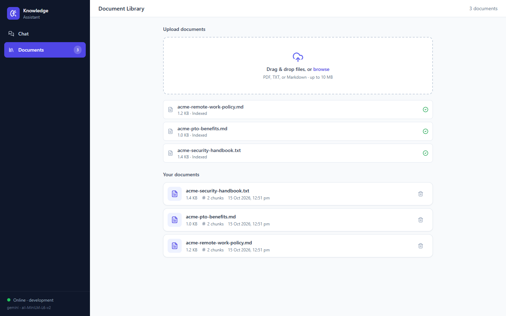
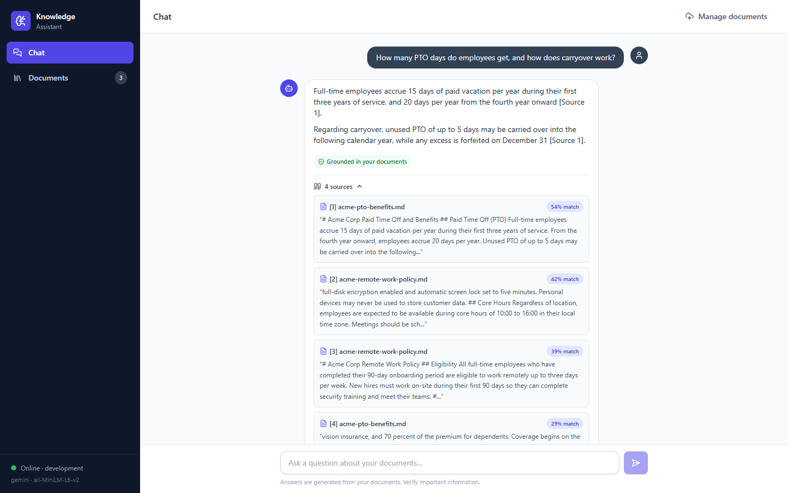
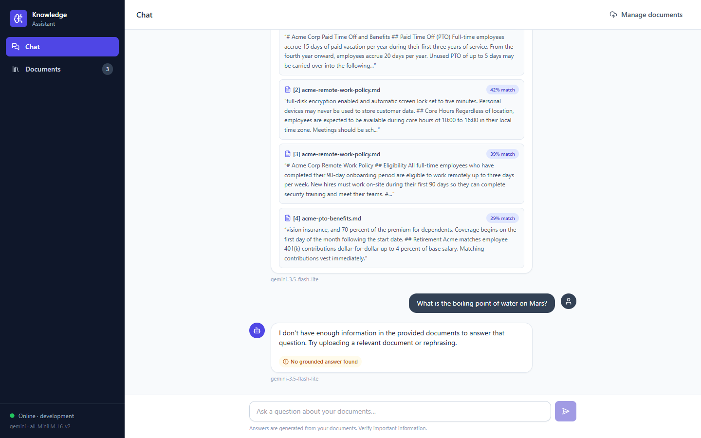
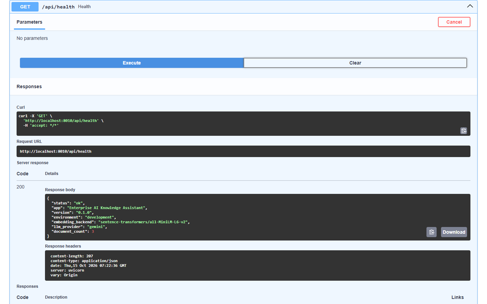
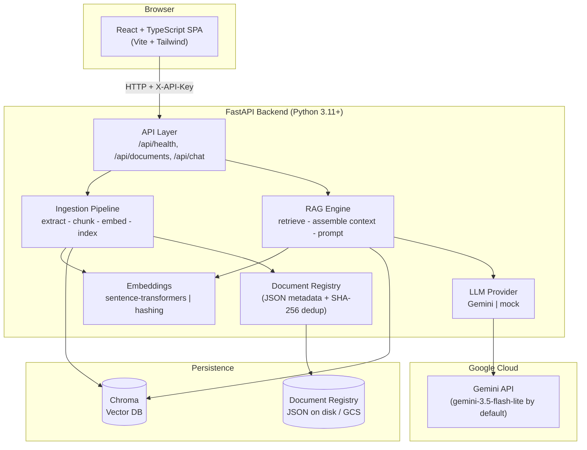
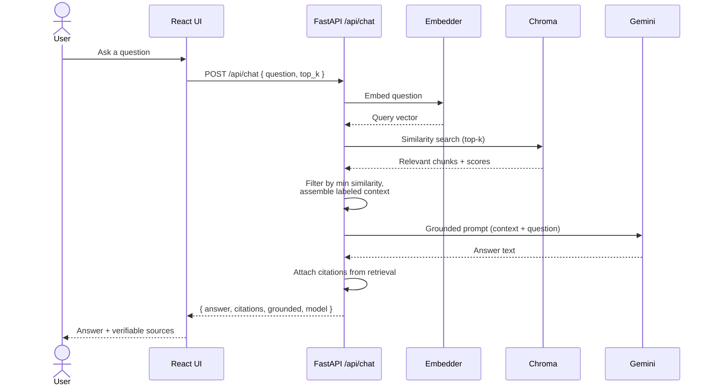

# Enterprise AI Knowledge Assistant

> Upload your documents, ask questions in plain English, and get answers that are **grounded in your own content** with **verifiable citations**. Retrieval-Augmented Generation (RAG) with FastAPI, Chroma, sentence-transformers and Google Gemini.

[](https://github.com/annadisandeep/enterprise-ai-knowledge-assistant/actions/workflows/ci.yml)


A **production-oriented portfolio project** by [Sandeep Annadi](https://github.com/annadisandeep) that demonstrates how to build a full-stack, cloud-deployable RAG application end-to-end: document ingestion, semantic retrieval, grounded generation, a typed API, a React UI, automated tests, CI, and Infrastructure-as-Code for Google Cloud.

> **Scope, stated plainly.** This is a portfolio project built to production-oriented standards. It is **not** a certified "enterprise-ready" product. Everything in the [Verification status](#verification-status) table was checked on a local machine; the Google Cloud deployment path is written and validated but has **not** been exercised against a real GCP project. See [docs/SECURITY.md](docs/SECURITY.md) for the full list of limitations.

---

## Table of contents

1. [Screenshots](#screenshots)
2. [What it does](#what-it-does)
3. [Verification status](#verification-status)
4. [Architecture](#architecture)
5. [How RAG works here](#how-rag-works-here)
6. [Tech stack](#tech-stack)
7. [Quickstart](#quickstart-local)
8. [Try it in five minutes](#try-it-in-five-minutes)
9. [Tests and CI](#tests-and-ci)
10. [Security summary](#security-summary)
11. [Cost summary](#cost-summary)
12. [Project structure](#project-structure)
13. [Documentation](#documentation)

---

## Screenshots

Captured on 2026-10-15 from the application running locally with the real semantic embedder (`all-MiniLM-L6-v2`) and the real Gemini provider (`gemini-3.5-flash-lite`). Only the synthetic ACME sample documents from `sample-data/` were uploaded; no private documents or credentials appear.

**Document upload and library.** Drag-and-drop or browse for PDF, TXT or Markdown files. Each file is validated, extracted, chunked, embedded and indexed, then listed with its size and chunk count.



**Gemini-generated answer with verifiable citations.** The answer is written by Gemini strictly from retrieved chunks. The "Grounded in your documents" badge comes from the backend, and every source card is built from the retrieval layer, with filename, similarity score and the exact snippet, so the model cannot invent a citation.



**Honest no-answer.** For a question the documents cannot answer, the backend returns an explicit no-answer with `grounded: false` and does not let the model guess. The small `gemini-3.5-flash-lite` label under each reply is the `model` field returned by the API.



**Health endpoint in the interactive API docs.** `/api/health` is public and reports the active embedding backend, LLM provider and document count without exposing any secret.



---

## What it does

Ask natural-language questions about documents you upload, and receive answers that are generated **only from the content of those documents**, each backed by citations you can verify.

- **Upload documents.** PDF, TXT, Markdown (`.pdf`, `.txt`, `.md`, `.markdown`), up to 10 MB each, with size, extension, magic-byte and binary-content validation and SHA-256 duplicate detection.
- **Automatic ingestion.** Text extraction (PyMuPDF for PDF), boundary-aware chunking (1000 characters, 150 overlap), embedding, and indexing into Chroma.
- **Semantic search.** Questions are embedded with `all-MiniLM-L6-v2` and matched by cosine similarity against every chunk; results below a minimum similarity are dropped.
- **Gemini-generated answers.** The retrieved chunks are assembled into a labeled context and sent to Gemini with a system prompt that forbids answering from outside that context.
- **Verifiable citations.** Every answer carries the source document, chunk, similarity score and snippet. Citations are built from the retrieval layer, never parsed out of the model's text.
- **Honest "no answer".** If nothing clears the similarity threshold, the API returns an explicit no-answer and the LLM is not called.
- **Pluggable AI.** Swap between semantic embeddings and a deterministic hashing fallback; swap between Gemini and a `mock` provider for offline, free, reproducible tests.
- **Secure by design.** API-key auth with constant-time comparison, strict CORS, upload validation, prompt-injection defenses, sanitized errors, non-root containers.
- **Cloud-ready.** Docker, docker-compose, GitHub Actions CI with dependency scanning, and Terraform for a scale-to-zero Cloud Run deployment.

---

## Verification status

Interviewers rightly ask what has actually been run. This table is the answer.

| Capability | How it was verified | Status |
|---|---|---|
| Document upload, extraction, chunking, indexing | Automated tests (hashing embedder) and a live local run with the semantic embedder; see the screenshots above | ✅ Locally verified |
| Semantic retrieval with `all-MiniLM-L6-v2` | Evaluation test over `sample-data/evaluation-set.json` (runs when the model is installed, 2 tests) and the live run above | ✅ Locally verified |
| Gemini-generated grounded answers | Real calls to the Gemini API with `gemini-3.5-flash-lite` on 2026-10-15 (screenshots above) and during the model-default fix on 2026-10-14 | ✅ Locally verified against the live API |
| Citations derived from retrieval | Automated citation-integrity and prompt-injection tests; visible in the chat screenshot | ✅ Locally verified |
| Explicit no-answer path | Automated tests (LLM not called) and the no-answer screenshot | ✅ Locally verified |
| API-key auth, CORS, upload validation, error mapping | Automated tests (67 backend tests pass) | ✅ Locally verified |
| React UI | 13 vitest tests pass; UI exercised end-to-end for the screenshots | ✅ Locally verified |
| Docker images and docker-compose | Dockerfiles and compose file are committed; CI builds the frontend, not the images | ⚠️ Not verified in this review |
| GitHub Actions CI | Workflow committed; lint, tests and audits run on push/PR to `main` | ✅ Workflow runs on GitHub |
| Terraform (Cloud Run, Artifact Registry, Secret Manager, GCS) | `terraform init -backend=false`, `fmt -check` and `validate` pass locally | ⚠️ Validated only; **never applied to a GCP project** |
| Manual deploy workflow (`deploy.yml`, Workload Identity Federation) | Committed and reviewed | ⚠️ Never triggered; no cloud deployment has been performed |

In short: **the RAG pipeline, the Gemini integration, the API, the UI and the test suite are real and were run locally; the Google Cloud deployment is designed, written and validated but unverified against a live account.** Nothing in this repository provisions cloud resources on its own.

---

## Architecture



See [docs/ARCHITECTURE.md](docs/ARCHITECTURE.md) for component responsibilities, the ingestion and query flows, and the design decisions (including the single-writer Chroma-on-GCS tradeoff).

---

## How RAG works here

Retrieval-Augmented Generation means the model is **not** asked to answer from memory. The app finds the most relevant pieces of **your** documents and hands them to Gemini as context, instructing it to answer **only** from that context.



Key properties: chunking is boundary-aware (default 1000 chars, 150 overlap); retrieval uses cosine similarity with a minimum-similarity threshold; **citations are derived from retrieval, never from model output**, so they cannot be hallucinated. Deep dive: [docs/RAG.md](docs/RAG.md).

---

## Tech stack

| Layer | Technology |
| --- | --- |
| **Backend** | Python 3.11 / 3.12, FastAPI 0.143, Pydantic v2, pydantic-settings, uvicorn |
| **RAG / AI** | Google Gemini (`gemini-3.5-flash-lite` by default, configurable via `GEMINI_MODEL`) through the official `google-genai` SDK; sentence-transformers `all-MiniLM-L6-v2` (384-dim) with a deterministic hashing fallback; Chroma vector DB; PyMuPDF for PDF text extraction |
| **Frontend** | React 18 + TypeScript 5 + Vite 5 + Tailwind CSS, sanitized Markdown rendering |
| **Testing** | pytest (backend, 67 tests), vitest + Testing Library (frontend, 13 tests) |
| **DevOps** | Docker, docker-compose, GitHub Actions CI (ruff, pytest, eslint, vitest, build, pip-audit, npm audit) |
| **Infrastructure** | Terraform for GCP: Cloud Run (scale-to-zero), Artifact Registry, Secret Manager, GCS bucket for durable Chroma storage; manual deploy workflow with Workload Identity Federation |

---

## Quickstart (local)

**Prerequisites:** Python 3.11 or 3.12, Node.js 20+, and optionally Docker. Full details, including Windows PowerShell commands and troubleshooting, in [docs/SETUP.md](docs/SETUP.md).

### 1. Backend

```bash
cd backend
python -m venv .venv
# Windows PowerShell:
.venv\Scripts\activate
# macOS/Linux:
source .venv/bin/activate

pip install -r requirements-dev.txt
cp .env.example .env            # then edit as needed
uvicorn app.main:app --reload --port 8000
```

The backend is now at `http://localhost:8000` (Swagger UI at `/docs`, health at `/api/health`).

> **Fast mode (no heavy ML deps, no API key):** set `EMBEDDING_BACKEND=hashing` and `LLM_PROVIDER=mock` in `.env`. This is the configuration CI uses.
>
> **Real answers:** keep `EMBEDDING_BACKEND=sentence-transformers` and `LLM_PROVIDER=gemini`, and set `GEMINI_API_KEY` (free tier from [ai.google.dev](https://ai.google.dev)). The embedding model downloads once on first use.

### 2. Frontend

```bash
cd frontend
npm install
npm run dev                     # http://localhost:5173
```

The dev server proxies `/api` to `http://localhost:8000` (override with `VITE_DEV_API_TARGET`), so no frontend configuration is needed for local use.

### 3. Or run both with Docker Compose

```bash
docker compose up --build       # from the repo root
```

Backend on `:8080`, frontend on `:5173`. Compose reads `backend/.env`, so create it from `.env.example` first.

---

## Try it in five minutes

1. Start the backend and frontend as above and open `http://localhost:5173`. The sidebar footer shows the active LLM provider and embedding model.
2. Click **Manage documents** and drop in the three synthetic files from `sample-data/`: `acme-remote-work-policy.md`, `acme-pto-benefits.md`, `acme-security-handbook.txt`. Each shows as *Indexed* with its chunk count.
3. Go back to **Chat** and ask: *How many PTO days do employees get, and how does carryover work?*
4. Read the answer, then expand **sources**. Each card names the file, shows a similarity score, and quotes the exact passage the answer came from.
5. Ask something the documents cannot answer, such as *What is the boiling point of water on Mars?* The assistant returns an explicit no-answer instead of guessing, and the backend never called the model.
6. Open `http://localhost:8000/docs`, run **GET /api/health**, and note that it reports provider and backend without exposing any key.

Talking points: citations are assembled server-side from retrieval results, the no-answer path short-circuits before the LLM, retrieved document text is wrapped as untrusted data in the prompt, and the whole pipeline is tested offline with the hashing embedder and mock provider.

---

## Tests and CI

Results from the local run on 2026-10-15:

| Suite | Command | Result |
|---|---|---|
| Backend (pytest, CI configuration) | `cd backend && EMBEDDING_BACKEND=hashing LLM_PROVIDER=mock pytest` | **67 passed**, 0 skipped, ~40 s |
| Frontend (vitest) | `cd frontend && npm run test` | **13 passed** across 5 files |
| Terraform | `cd infrastructure/terraform && terraform init -backend=false && terraform validate` | Success, configuration valid |

Backend tests by file:

| File | Tests | Covers |
|---|---|---|
| `test_extraction.py` | 10 | Unsupported extension, empty and oversized files, PDF magic-byte check, text/Markdown decoding, binary and whitespace-only rejection, PDF round-trip |
| `test_rag_engine.py` | 8 | Real citations, no-answer without calling the LLM, ungrounded fallback marking, prompt-injection text contained as data, citation chunk ids, configurable top-k |
| `test_chat_api.py` | 7 | `/api/chat` contract, validation, provider error mapping (503 / 504 / 429 / 502) |
| `test_auth.py` | 6 | `X-API-Key` enforcement when `API_KEY` is set; health stays public |
| `test_chunking.py` | 6 | Boundary-aware splitting, sizes and overlap |
| `test_documents_api.py` | 6 | Upload, list and count; duplicate (409), unsupported type and empty file (422); delete and 404 |
| `test_llm_provider.py` | 6 | Missing key is a config error; timeout, quota and auth errors mapped; empty response is an upstream error; successful generation |
| `test_config.py` | 5 | Default Gemini model id, override via init and env, provider configurable |
| `test_embeddings.py` | 5 | Hashing embedder dimension and normalisation, determinism, lexical ordering, factory, empty-text vector |
| `test_retrieval.py` | 4 | Top-k search, cosine similarity, `MIN_SIMILARITY`, per-document scoping |
| `test_eval.py` | 2 | Semantic retrieval quality over `sample-data/evaluation-set.json` (auto-skips without sentence-transformers) |
| `test_health.py` | 2 | Health response fields and root liveness |

The external AI is **mocked in the automated suite**: the hashing embedder and the mock provider make tests fast, free and deterministic, so CI needs no key and makes no network calls. The two semantic evaluation tests ran locally because the model is installed; in the slim CI environment they skip by design.

CI (`.github/workflows/ci.yml`) runs on push and pull request to `main`: ruff + pytest, eslint + vitest + production build, and non-blocking `pip-audit` / `npm audit`. The deploy workflow is a separate, **manual** `workflow_dispatch` job that has never been triggered. See [docs/TESTING.md](docs/TESTING.md).

---

## Security summary

Implemented: environment-based config (no hardcoded secrets), API-key auth for deployed environments (constant-time comparison), configurable CORS (no wildcard in production, credentials disabled, header-based auth), upload size/type/magic-byte validation (`%PDF-`), binary-content rejection for text, SHA-256 duplicate detection, prompt-injection defenses (retrieved context treated as untrusted; citations derived from retrieval, not model output), explicit no-answer fallback, sanitized error messages, non-root Docker images, and dependency scanning (pip-audit, npm audit) in CI.

**Honest limitations:** single shared API key (no per-user auth or RBAC), a single shared knowledge base (no multi-tenant document isolation), no app-layer rate limiting, a single-writer vector store on GCS, and a demo-only pattern of shipping `VITE_API_KEY` to the browser. Read [docs/SECURITY.md](docs/SECURITY.md) before drawing conclusions.

---

## Cost summary

| Scenario | Rough cost |
| --- | --- |
| Local development | **Free** (local embeddings; `LLM_PROVIDER=mock` avoids any AI calls) |
| Gemini API | **Free tier** available via Google AI Studio; check current limits at [ai.google.dev](https://ai.google.dev) |
| GCP demo (Cloud Run scaled to zero + small GCS bucket + Secret Manager) | **~$0 to a few dollars/month** when idle |

Always keep `backend_min_instances = 0`, enable a **budget alert**, and run `terraform destroy` when done. Details: [docs/COST.md](docs/COST.md).

---

## Project structure

```
enterprise-ai-knowledge-assistant/
├── backend/
│   ├── app/
│   │   ├── api/            # FastAPI routes: health, documents, chat
│   │   ├── core/           # config, logging, security, DI container
│   │   ├── models/         # Pydantic schemas
│   │   └── services/       # extraction, chunking, embeddings, vector_store,
│   │                       # document_registry, llm_provider, rag_engine, ingestion
│   ├── tests/              # 67 pytest tests
│   ├── requirements.txt / requirements-dev.txt
│   ├── Dockerfile
│   └── .env.example
├── frontend/
│   ├── src/                # React + TypeScript SPA (13 vitest tests)
│   ├── Dockerfile / nginx.conf
│   └── package.json
├── infrastructure/terraform/   # GCP: Cloud Run, Artifact Registry, Secret Manager, GCS
├── .github/workflows/      # ci.yml (automatic), deploy.yml (manual only)
├── sample-data/            # synthetic ACME documents + evaluation-set.json
├── docs/                   # guides + screenshots/
└── README.md
```

---

## Documentation

| Document | What's inside |
| --- | --- |
| [docs/ARCHITECTURE.md](docs/ARCHITECTURE.md) | Component responsibilities, diagrams, stateless Cloud Run + GCS design |
| [docs/SETUP.md](docs/SETUP.md) | Full local setup (Windows + macOS/Linux), Docker, troubleshooting |
| [docs/CONFIGURATION.md](docs/CONFIGURATION.md) | Every environment variable, embedding backends, LLM providers |
| [docs/RAG.md](docs/RAG.md) | How RAG works and exactly how this app implements it |
| [docs/API.md](docs/API.md) | Full REST API reference with curl examples and error codes |
| [docs/TESTING.md](docs/TESTING.md) | Running backend + frontend tests, coverage, the mock strategy |
| [docs/DEPLOYMENT.md](docs/DEPLOYMENT.md) | GCP deployment via Terraform, Cloud Run, the manual deploy workflow |
| [docs/SECURITY.md](docs/SECURITY.md) | Implemented controls **and** honest limitations |
| [docs/COST.md](docs/COST.md) | Cost considerations for local and cloud |
| [docs/PORTFOLIO.md](docs/PORTFOLIO.md) | Portfolio write-up, skills, LinkedIn entry, interview talking points |
| [infrastructure/terraform/README.md](infrastructure/terraform/README.md) | Terraform module notes |

---

## License

Released under the **MIT License**. See [LICENSE](LICENSE).

## Author

**Sandeep Annadi**, [GitHub @annadisandeep](https://github.com/annadisandeep)

Repository: [github.com/annadisandeep/enterprise-ai-knowledge-assistant](https://github.com/annadisandeep/enterprise-ai-knowledge-assistant)
