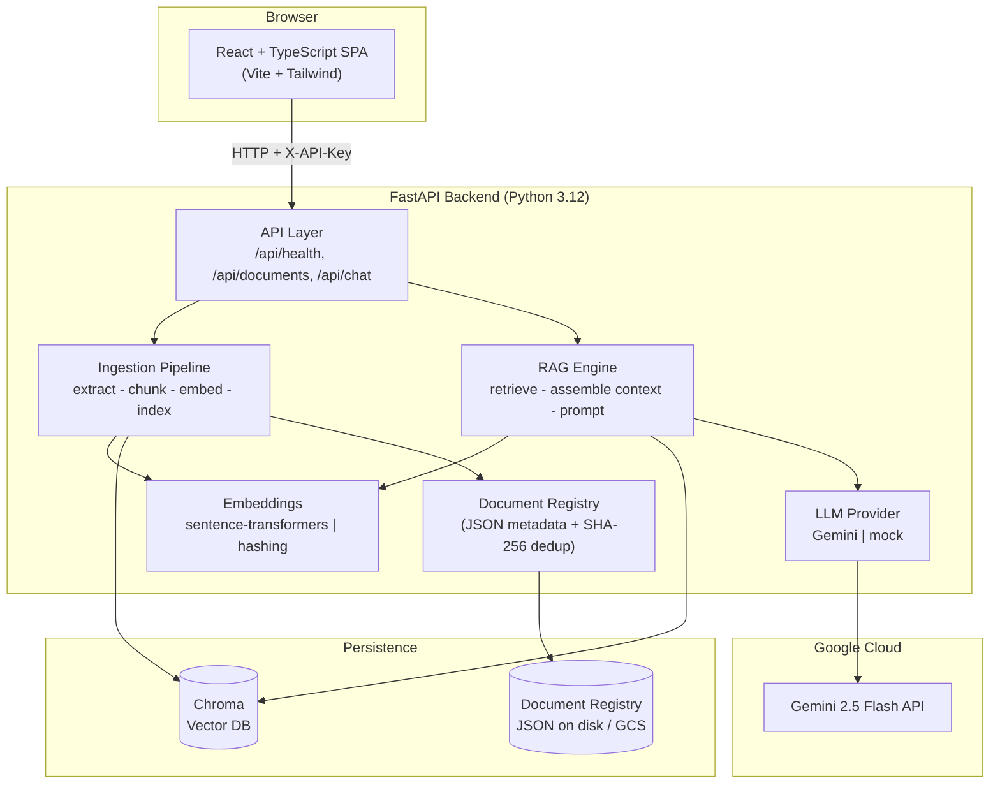
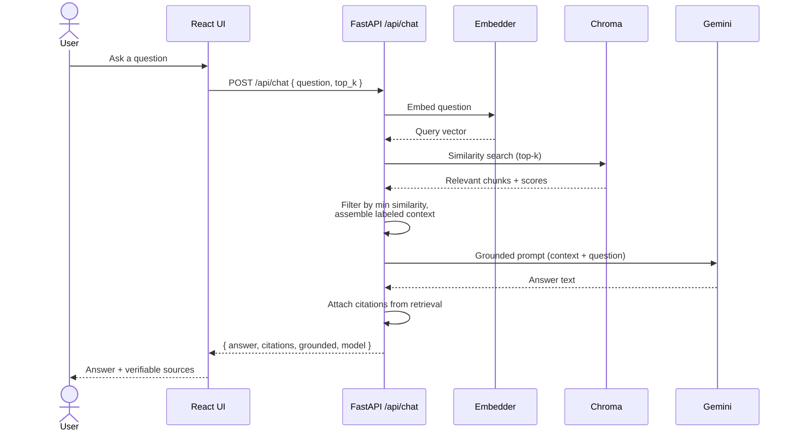

# Enterprise AI Knowledge Assistant

> Upload your documents, ask questions in plain English, and get answers that are **grounded in your own content** with **real citations** — powered by Retrieval-Augmented Generation (RAG) and Google Gemini.


A **production-oriented portfolio project** by [Sandeep Annadi](https://github.com/annadisandeep) that demonstrates how to build a full-stack, cloud-deployable RAG application end-to-end: document ingestion, semantic retrieval, grounded generation, a typed API, a React UI, automated tests, CI/CD, and Infrastructure-as-Code for Google Cloud.

> **Note on scope:** This is a portfolio project built to production-oriented standards. It is **not** a certified "enterprise-ready" product. See [docs/SECURITY.md](docs/SECURITY.md) for an honest list of implemented controls and known limitations.

---

## What it does

Ask natural-language questions about documents you upload, and receive answers that are generated **only from the content of those documents**, each backed by citations you can verify.

- **Upload documents** — PDF, TXT, Markdown (`.pdf`, `.txt`, `.md`, `.markdown`), up to 10 MB each.
- **Automatic ingestion** — text extraction, boundary-aware chunking, embedding, and indexing into a vector database.
- **Grounded Q&A** — questions are answered from retrieved document chunks, never from the model's general knowledge alone.
- **Real citations** — every answer links back to the source document, chunk, and a snippet. Citations are built from the retrieval layer, so the model **cannot fabricate them**.
- **Honest "no answer"** — if the documents do not contain the answer, the assistant says so rather than guessing.
- **Pluggable AI** — swap between semantic embeddings (sentence-transformers) and a fast deterministic fallback; swap between Google Gemini and a `mock` provider for offline testing.
- **Secure by design** — API-key auth, strict CORS, upload validation, and prompt-injection defenses (see below).
- **Cloud-ready** — Docker, docker-compose, GitHub Actions CI, and Terraform for a Cloud Run deployment.

---

## Architecture



See [docs/ARCHITECTURE.md](docs/ARCHITECTURE.md) for the full breakdown.

---

## Tech stack

| Layer | Technology |
| --- | --- |
| **Backend** | Python 3.12 (3.11 works locally), FastAPI, Pydantic v2, pydantic-settings, uvicorn |
| **RAG / AI** | Google Gemini (`gemini-3.5-flash-lite`, configurable via `GEMINI_MODEL`) via `google-genai`; sentence-transformers `all-MiniLM-L6-v2` (384-dim) with a deterministic hashing fallback; Chroma vector DB; PyMuPDF for PDF text extraction |
| **Frontend** | React + TypeScript + Vite + Tailwind CSS (static SPA) |
| **Testing** | pytest (backend), vitest + Testing Library (frontend) |
| **DevOps** | Docker, docker-compose, GitHub Actions CI (incl. pip-audit / npm audit) |
| **Infrastructure** | Terraform for GCP: Cloud Run, Artifact Registry, Secret Manager, GCS bucket (durable Chroma storage) |

---

## Quickstart (local)

**Prerequisites:** Python 3.11 or 3.12, Node.js 20+, and (optionally) Docker. Full details in [docs/SETUP.md](docs/SETUP.md).

### 1. Backend

```bash
cd backend
python -m venv .venv
# Windows PowerShell:
.venv\Scripts\activate
# macOS/Linux:
source .venv/bin/activate

pip install -r requirements-dev.txt
cp .env.example .env            # then edit as needed
uvicorn app.main:app --reload --port 8000
```

Backend is now live at `http://localhost:8000` (docs at `/docs`, health at `/api/health`).

> **Fast mode (no heavy ML deps, no API key):** set `EMBEDDING_BACKEND=hashing` and `LLM_PROVIDER=mock` in your `.env`. Great for CI and quick experiments.

### 2. Frontend

```bash
cd frontend
npm install
npm run dev                     # dev server on http://localhost:5173
```

The dev server talks to the backend via `VITE_API_BASE_URL` (default `http://localhost:8000/api` in local dev).

### 3. Or run both with Docker Compose

```bash
docker compose up --build       # from repo root
```

Backend on `:8080`, frontend on `:5173`.

---

## How RAG works here

Retrieval-Augmented Generation means the model is **not** asked to answer from memory. Instead, the app finds the most relevant pieces of **your** documents and gives them to Gemini as context, instructing it to answer **only** from that context.



Key properties: chunking is boundary-aware (default 1000 chars, 150 overlap); retrieval uses cosine similarity with a minimum-similarity threshold; **citations are derived from retrieval, never from model output**, so they cannot be hallucinated. Deep dive: [docs/RAG.md](docs/RAG.md).

---

## Project structure

```
enterprise-ai-knowledge-assistant/
├── backend/
│   ├── app/
│   │   ├── api/            # FastAPI routes: health, documents, chat
│   │   ├── core/           # config, logging, DI container
│   │   ├── models/         # Pydantic schemas
│   │   └── services/       # extraction, chunking, embeddings,
│   │                       # vector_store, document_registry,
│   │                       # llm_provider, rag_engine, ingestion
│   ├── tests/
│   ├── requirements.txt
│   ├── requirements-dev.txt
│   ├── Dockerfile
│   └── .env.example
├── frontend/
│   ├── src/                # React + TypeScript SPA
│   ├── Dockerfile
│   ├── nginx.conf
│   └── package.json
├── infrastructure/
│   └── terraform/          # GCP: Cloud Run, Artifact Registry, Secret Manager, GCS
├── .github/
│   └── workflows/          # ci.yml, deploy.yml
├── sample-data/            # acme-*.md/.txt + evaluation-set.json
├── docs/
└── README.md
```

---

## Documentation

| Document | What's inside |
| --- | --- |
| [docs/ARCHITECTURE.md](docs/ARCHITECTURE.md) | Component responsibilities, diagrams, stateless Cloud Run + GCS design |
| [docs/SETUP.md](docs/SETUP.md) | Full local setup (Windows + macOS/Linux), Docker, troubleshooting |
| [docs/CONFIGURATION.md](docs/CONFIGURATION.md) | Every environment variable, embedding backends, LLM providers |
| [docs/RAG.md](docs/RAG.md) | How RAG works and exactly how this app implements it |
| [docs/API.md](docs/API.md) | Full REST API reference with curl examples and error codes |
| [docs/TESTING.md](docs/TESTING.md) | Running backend + frontend tests, coverage, the mock strategy |
| [docs/DEPLOYMENT.md](docs/DEPLOYMENT.md) | GCP deployment via Terraform, Cloud Run, CI/CD |
| [docs/SECURITY.md](docs/SECURITY.md) | Implemented controls **and** honest limitations |
| [docs/COST.md](docs/COST.md) | Cost considerations for local and cloud |
| [docs/PORTFOLIO.md](docs/PORTFOLIO.md) | Portfolio write-up, skills, LinkedIn entry, interview talking points |

---

## Security summary

Implemented: environment-based config (no hardcoded secrets), API-key auth for deployed environments (constant-time comparison), configurable CORS (no wildcard in production, credentials disabled, header-based auth), upload size/type/magic-byte validation (`%PDF-`), binary-content rejection for text, SHA-256 duplicate detection, prompt-injection defenses (retrieved context treated as untrusted; citations derived from retrieval not model output), explicit no-answer fallback, sanitized error messages, non-root Docker images, and dependency scanning (pip-audit, npm audit) in CI.

**Honest limitations:** single shared API key (no per-user auth/RBAC), a single shared knowledge base (no multi-tenant document isolation), no app-layer rate limiting, and more. This is **not** a certified enterprise product. Read [docs/SECURITY.md](docs/SECURITY.md) before drawing conclusions.

---

## Cost summary

| Scenario | Rough cost |
| --- | --- |
| Local development | **Free** (uses local embeddings; use `LLM_PROVIDER=mock` to avoid any AI calls) |
| Gemini API | **Free tier** available via Google AI Studio — check current limits at [ai.google.dev](https://ai.google.dev) |
| GCP demo (Cloud Run scaled to zero + small GCS bucket + Secret Manager) | **~$0 to a few dollars/month** if idle and scaled to zero |

Always set `min_instances = 0`, enable a **budget alert**, and run `terraform destroy` when done. Details: [docs/COST.md](docs/COST.md).

---

## Screenshots

> _Screenshots coming soon._

| View | Preview |
| --- | --- |
| Document upload | _`docs/screenshots/upload.png` (placeholder)_ |
| Chat with citations | _`docs/screenshots/chat.png` (placeholder)_ |
| Health / status | _`docs/screenshots/health.png` (placeholder)_ |

---

## License

Released under the **MIT License**.

## Author

**Sandeep Annadi** — [GitHub @annadisandeep](https://github.com/annadisandeep)

Repository: [github.com/annadisandeep/enterprise-ai-knowledge-assistant](https://github.com/annadisandeep/enterprise-ai-knowledge-assistant)
