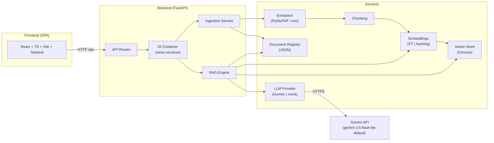
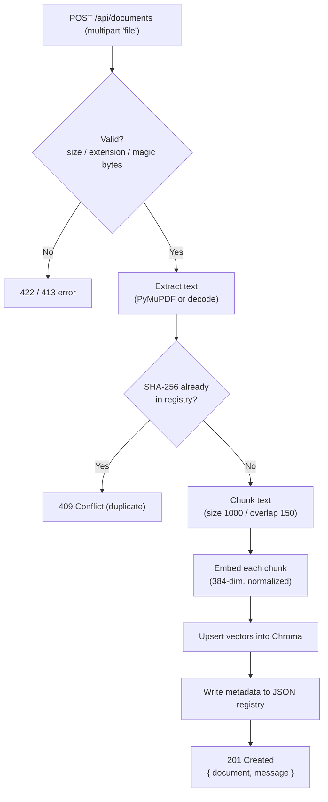
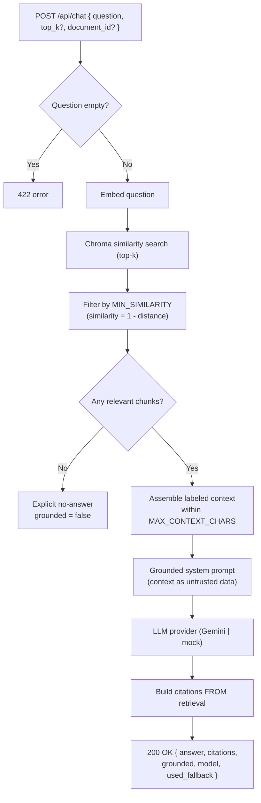
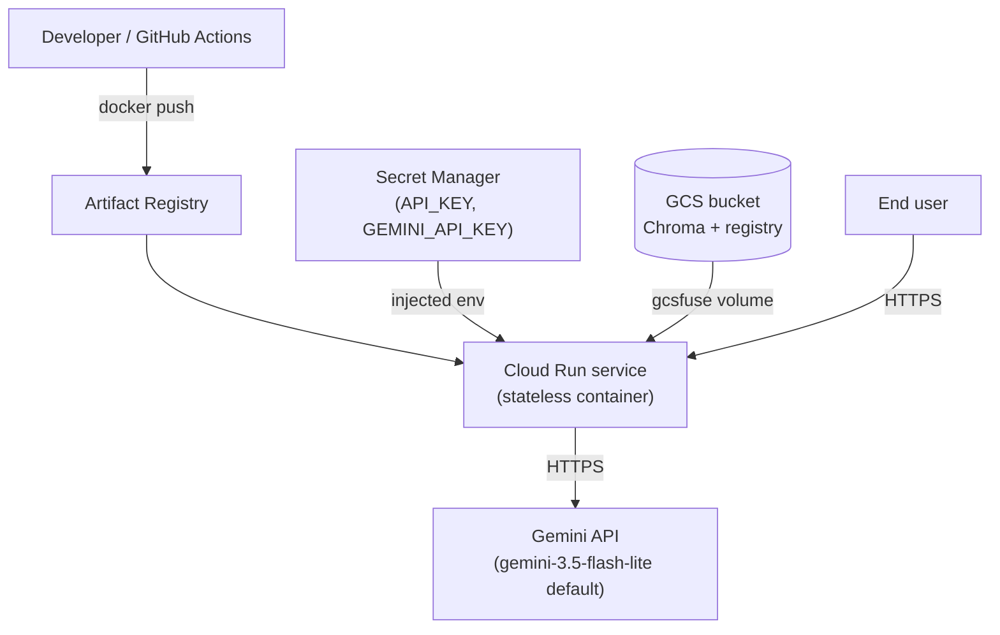

# Architecture

This document explains how the **Enterprise AI Knowledge Assistant** is put together: the components, how data flows during ingestion and querying, and the reasoning behind the key design decisions (especially the stateless Cloud Run + GCS persistence model).

For a beginner-friendly overview, start with the [README](../README.md). For the RAG specifics, see [RAG.md](RAG.md).

---

## High-level view

The system has three tiers:

1. **Frontend** — a static React + TypeScript single-page app (SPA) that talks to the backend over HTTP.
2. **Backend** — a FastAPI service that handles document ingestion and question answering, orchestrating a set of focused services.
3. **Persistence + external AI** — a Chroma vector database, a JSON document registry, and the Google Gemini API.

---

## Component responsibilities

### Extraction (`app/services/extraction.py`)
Turns an uploaded file into plain text.
- **PDF** → extracted with **PyMuPDF**, after validating the `%PDF-` magic bytes.
- **TXT / Markdown** → decoded as text, with **binary-content rejection** (files that look binary are refused rather than producing garbage text).
- Empty or unreadable content results in a `422` error.

### Chunking (`app/services/chunking.py`)
Splits long text into overlapping, boundary-aware chunks so that retrieval returns coherent passages.
- Default **chunk size 1000 characters**, **overlap 150 characters** (`CHUNK_SIZE`, `CHUNK_OVERLAP`).
- Boundary-aware: prefers to split on natural boundaries (paragraphs, sentences) rather than mid-word, falling back to hard splits only when necessary.
- Overlap preserves context that would otherwise be lost at chunk edges.

### Embeddings — pluggable backends (`app/services/embeddings.py`)
Converts text into numeric vectors for similarity search. **Two interchangeable backends** behind one interface:

| Backend | How it works | When to use |
| --- | --- | --- |
| `sentence-transformers` | Semantic embeddings using `all-MiniLM-L6-v2` (384-dim), normalized | Production / realistic retrieval quality |
| `hashing` | Deterministic lexical embedder (hash-based, 384-dim) | CI, tests, and fast local runs — no model download, no GPU |

Both produce **384-dimensional** vectors and are normalized so that cosine similarity is a meaningful score. Selected via `EMBEDDING_BACKEND`.

### Vector store (`app/services/vector_store.py`)
Wraps a **Chroma** persistent collection.
- Stores chunk vectors plus lightweight metadata (document id, filename, chunk index).
- Persists to `CHROMA_PERSIST_DIR` (default `./data/chroma`).
- Provides similarity search returning chunks and distances; the RAG engine converts distance to cosine similarity (`similarity = 1 - distance`).

### Document registry (`app/services/document_registry.py`)
A small **JSON file** that is the source of truth for **document-level metadata**:
- `id`, `filename`, `content_type`, `size_bytes`, `char_count`, `chunk_count`, `sha256`, `uploaded_at`.
- Enables **duplicate detection** by SHA-256 (same file content → `409 Conflict`).
- Enables listing documents and counting them for the health endpoint without scanning the vector DB.

**Why a JSON registry separate from Chroma?** See [Design decisions](#design-decisions) below.

### RAG engine (`app/services/rag_engine.py`)
The heart of question answering:
1. Embeds the question.
2. Runs a top-k similarity search (optionally filtered to a single `document_id`).
3. Drops results below `MIN_SIMILARITY`.
4. Assembles a **labeled context** within the `MAX_CONTEXT_CHARS` budget, wrapping untrusted document text in delimiters.
5. Builds a **grounded system prompt** that forbids answering outside the provided context and forbids following any instructions found inside documents.
6. Calls the LLM provider and returns the answer.
7. **Builds citations from the retrieved chunks** (not from the model output) so citations are always real.
8. If nothing relevant is retrieved, returns an explicit no-answer response with `grounded: false`.

### LLM provider abstraction (`app/services/llm_provider.py`)
A single interface with two implementations:

| Provider | Behavior |
| --- | --- |
| `gemini` | Calls the configured Gemini model (default **`gemini-3.5-flash-lite`**, set via `GEMINI_MODEL`) through the official `google-genai` SDK, with temperature, max-output-tokens, and timeout settings |
| `mock` | Returns a deterministic canned answer — no network, no API key — used in tests/CI |

Provider errors map to clean HTTP codes: `503` (missing/invalid credentials), `504` (timeout), `429` (quota), `502` (other provider error).

### Ingestion service (`app/services/ingestion.py`)
Orchestrates the upload path: validate → extract → chunk → embed → index → register. Keeps the route handler thin.

### FastAPI layer (`app/api/*`, `app/main.py`)
- `routes_health.py` — liveness and health/status (public).
- `routes_documents.py` — upload, list, delete.
- `routes_chat.py` — question answering.
- Cross-cutting: API-key auth dependency (active only when `API_KEY` is set), CORS middleware, structured logging, and consistent error shaping.

### Container / dependency injection (`app/core/container.py`)
A lightweight composition root that constructs services once (embedder, vector store, registry, LLM provider, RAG engine) from configuration and injects them into routes. This makes the services easy to swap and to test in isolation.

### Configuration (`app/core/config.py`)
Pydantic-settings `Settings` object loaded from environment variables / `.env`. All tunables (chunk sizes, thresholds, model names, provider choices) live here — no magic constants scattered through the code. See [CONFIGURATION.md](CONFIGURATION.md).

### Frontend (`frontend/src`)
A React + TypeScript SPA built with Vite and styled with Tailwind. It:
- Uploads documents and lists them.
- Sends questions to `/api/chat` and renders answers as **sanitized Markdown**.
- Shows citations with document name, snippet, and similarity.
- Reads its API base URL from `VITE_API_BASE_URL` and an optional `VITE_API_KEY`.

---

## Ingestion flow

## Query flow

---

## Deployment topology (GCP)

See [DEPLOYMENT.md](DEPLOYMENT.md) for the step-by-step guide.

---

## Design decisions

### Stateless Cloud Run + GCS-backed persistence
Cloud Run containers are **ephemeral and stateless** — local disk does not survive restarts or scale events, and multiple instances don't share a local filesystem. The RAG app, however, needs **durable** storage for the Chroma vectors and the document registry.

The design mounts a **GCS bucket as a volume (gcsfuse)** so that `CHROMA_PERSIST_DIR` and the registry JSON live in object storage. This keeps the demo architecture simple and cheap while surviving restarts.

**Tradeoff (stated honestly):** gcsfuse is not a high-performance, strongly-consistent database. It is fine for a single-instance demo, but for higher scale or concurrent writers you would move to a **managed vector database** (e.g., a hosted Chroma, pgvector/Cloud SQL, or a dedicated vector service) and a managed metadata store. This is called out in [DEPLOYMENT.md](DEPLOYMENT.md) and [SECURITY.md](SECURITY.md).

### Metadata in JSON, vectors in Chroma
Two different jobs, two different stores:

- **Chroma** is optimized for **vector similarity search** over chunk embeddings. It is the right tool for "find the most relevant passages."
- The **JSON registry** holds **document-level truth** — the canonical list of documents, their SHA-256 hashes for duplicate detection, sizes, and timestamps. Keeping this separate makes document listing, counting, and dedup fast and simple, and avoids coupling business metadata to the vector index's internals. It also means the health endpoint can report `document_count` cheaply.

This separation mirrors a common real-world pattern: a **system of record** for metadata plus a **specialized index** for search.

### Pluggable embeddings and LLM providers
Both embeddings and the LLM sit behind narrow interfaces with a lightweight (no-network) alternative. This gives:
- **Fast, deterministic CI** (hashing embedder + mock LLM — no model download, no API key, no cost).
- **Easy local experimentation** without a Gemini key.
- A clean seam to swap in a different model or provider later.

### Configuration over hardcoding
Every tunable is an environment variable resolved through a single Pydantic settings object. Nothing sensitive is baked into the image, which is both a security and a flexibility win.

---

## Related docs

- [RAG.md](RAG.md) — the retrieval and generation internals in detail
- [CONFIGURATION.md](CONFIGURATION.md) — every environment variable
- [API.md](API.md) — the HTTP contract
- [DEPLOYMENT.md](DEPLOYMENT.md) — running it on GCP
- [SECURITY.md](SECURITY.md) — controls and limitations
